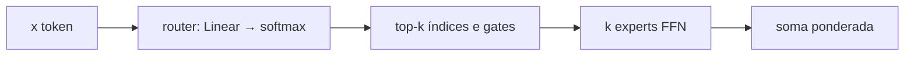

# A11 — MoE, quantização e inferência eficiente

Trilha avançada, **opcional**. Guia da pasta: [`README.md`](./README.md). Checkpoint: [`checkpoint-ca11.md`](./checkpoint-ca11.md). Esta aula **não** contém gabarito de CA11.

Você já reconstruiu um bloco denso no A2 (atenção causal, FFN, RMSNorm). No M08 leu que “MoE ≠ multiagente”. No M09 treinou LoRA em `q_proj`/`v_proj` e viu NF4 no QLoRA sem abrir a conta de *quando* a quantização acontece. Aqui a conta abre em três frentes: **quem** calcula (experts), **com quantos bits** (PTQ/QAT) e **o que não se recalcula** (KV cache).

Ao final você deve conseguir, no papel e no código:

1. escrever a saída de uma camada MoE com router top-*k* e dizer o que *não* entra na soma;
2. calcular a aux loss do Switch, `N · Σ f_i P_i`, e reconhecer colapso de experts;
3. ler numa `config` real `num_local_experts` vs `num_experts_per_tok`;
4. contrastar PTQ (depois do treino) e QAT (durante, com STE);
5. explicar por que KV cache muda a complexidade da geração e o que *batching estático* ainda não faz.

Nada disto entra nas 240 h. Não substitui C09.*. Os números miúdos do router foram conferidos em [`lab/moe_brinquedo.py`](./lab/moe_brinquedo.py) (`exemplo_numerico_aula`). Perplexidade, bytes e latência **não** se copiam da aula: saem do seu `ca11.json`.

---

## 0. Honestidade de dependências

A ordem de *construção* da trilha entregou A2 e agora A11. **A3 (MiniGPT), A5 (SFT) e A6 (LoRA de produção) ainda são esqueleto.** Consequências, escritas para não haver magia:

| O plano original pedia | O que este módulo faz |
| --- | --- |
| MoE dentro do MiniGPT do A3 | camada MoE **avulsa** (clusters → router → 8 experts) |
| LoRA em atenção vs experts (CA11.3) | **não executado**; ponte conceitual = LoRA do M09 em `q_proj`/`v_proj` |
| SFT do A5 em fp16 / int8 / NF4 / GGUF | PTQ weight-only no **SmolLM2-135M** (mesmo id do A2), corpus original curto |
| QAT no MiniGPT | MLP 1-D que aproxima `sin(x)` |
| vLLM / llama-server na T4 | leitura + campo `nao_calibrado` no JSON |

Se você abrir o JSON e CA11.3 estiver `nao_executado`, isso é o desenho, não um bug seu.

---

## 1. Denso, esparso, e o que MoE *não* é

No bloco do A2, o FFN (`sobe` → ativação → `desce`) roda em **todo** token. Se o FFN tem `P` parâmetros, cada token paga `P`. Um modelo “1B denso” ativa ~1B pesos por token (menos embedding/atenção à parte).

Mixture-of-Experts troca esse FFN por *N* cópias + um **router**. Só *k* cópias entram na soma. Os parâmetros *existem* todos (cabem na RAM/VRAM); o FLOP por token segue ~ *k/N* do FFN. Granite 3.1-1B-A400M: ~1,3B no disco, ~400M ativos por token, 32 experts, *k*=8 (card Apache-2.0, tabela da arquitetura). OLMoE-1B-7B: 64 experts, *k*=8, ~7B totais / ~1B ativos — pesado demais para esta CPU; o lab lê só a `config`.

O M08 já avisou: MoE **não** é um time de agentes. Não há ferramenta, não há ReAct, não há “o expert de funilaria discute com o de saúde”. Há um softmax sobre *N* logits e um `topk`. Dois tokens da mesma frase podem cair em experts diferentes; o mesmo expert pode atender “placa” e `def`. Especialização é *hipótese mensurável*, não definição.



Atenção (Q/K/V) no Granite **continua densa**. O que fica esparso é o MLP. Mixtral 8×7B (Jiang et al. 2024) é o mesmo desenho com *N*=8, *k*=2.

---

## 2. Router top-*k* — conta à mão

Dois tokens, três experts, *k*=2. Logits do router (já depois de `x W_r + b`):

```text
token 0:  [ 2.0 ,  0.0 , -1.0 ]
token 1:  [ 2.0 ,  0.5 , -1.0 ]
```

Softmax por linha (probabilidade *sobre os três*, usada na aux loss):

```text
p0 ≈ [0.84379470, 0.11419519, 0.04201007]
p1 ≈ [0.78559703, 0.17529039, 0.03911257]
```

`topk(2)` nos **logits** (não nas probs — o argmax coincide):

```text
token 0 escolhe experts 0 e 1
token 1 escolhe experts 0 e 1
```

Os *gates* que multiplicam a saída do expert são um softmax **só no top-*k***:

```text
g0 ≈ [0.88079703, 0.11920291]     # experts 0 e 1
g1 ≈ [0.81757444, 0.18242551]
```

Expert 2 **não é chamado**. Se você zerar os pesos dele, a saída destes dois tokens não muda. Isso é o ganho de FLOP — e o risco de o expert 2 nunca mais receber gradiente.

A saída da camada (um token):

```text
y = g₀ E₀(x) + g₁ E₁(x)
```

Shazeer et al. 2017 escrevem `y = Σ_i G(x)_i E_i(x)` e simplesmente não avaliam onde `G=0`. Switch (Fedus et al. 2021) simplifica para *k*=1: um expert, o gate ainda entra para o router receber gradiente. O brinquedo deste lab usa *k*=2 (Mixtral / Granite-*k*=8 no espírito; números pequenos no caderno).

Rode `python modulo-a11/lab/moe_brinquedo.py` via `lab_a11.py` e confira o **seu** `exemplo_aula`. Não copie o da aula no CA11 se o JSON divergir — o tensor está fixo no código, deve bater.

---

## 3. Aux loss: `N · Σ f_i P_i`

Sem pressão, o router descobre um atalho: mandar quase tudo para o expert que já está um pouco melhor. Esse expert treina mais, os outros atrofiam — **colapso**.

Switch (Fedus et al., §2, “A Differentiable Load Balancing Loss”) mede dois vetores no lote:

- `f_i` — fração de tokens *despachados* ao expert *i* (aqui: o expert entrou no top-*k*; com *k*=2, `Σ f` vale 2, não 1);
- `P_i` — média das probs do softmax cheio nesse expert.

A perda auxiliar é

```text
L_aux = N · Σ_i f_i P_i
```

Uniforme com *k*=1: `f_i = P_i = 1/N` ⇒ `L_aux = 1`. O `N` na frente mantém a escala quando você muda o número de experts. No treino: `L = L_tarefa + α L_aux`. O paper usa `α = 10⁻²`; o brinquedo usa `α = 0,05` porque o lote é minúsculo e o router começa com viés +2,5 no expert 0 (para *induzir* o colapso — sem isso, 8 experts em 250 passos às vezes já se equilibram por acaso, e a aula mentiria).

No exemplo 2×3:

```text
f  = [1.0, 1.0, 0.0]          # os dois tokens bateram em 0 e 1
P  ≈ [0.81469584, 0.14474279, 0.04056132]
L_aux ≈ 3 × (1·0.8147 + 1·0.1447 + 0) ≈ 2.878316
```

Expert 2: `f=0`. Sem aux, o gradiente dele só existiria se algum token o escolhesse. Com aux, `P_2` ainda puxa o router.

O lab treina o mesmo problema (reconstruir o vetor canônico de um cluster) **com** e **sem** aux. Critério operacional, não teologia:

- colapso: `f_max ≥ 0,50` sem aux (na autoria, expert 0 ficou em 1,0 — estava no top-2 de *todos* os tokens);
- equilíbrio: entropia de `f` sobe **e** `f_max` cai quando `α>0`.

MSE da tarefa pode até piorar um pouco com aux: o modelo deixa de especializar num único expert. Isso é o preço visível. CA11.1 pede as *flags*, não o MSE mínimo.

Parâmetros no brinquedo (`d=32`, `d_ff=64`, *N*=8, *k*=2): totais = router + 8 experts; ativos por token = router + 2 experts. A fração não é exatamente *k/N* porque o router entra nos dois lados. O JSON traz a conta.

---

## 4. Um MoE de verdade (sem treinar)

`config.json` de `ibm-granite/granite-3.1-1b-a400m-instruct` (Apache-2.0, `model_type=granitemoe`):

| Campo | Valor | Leitura |
| --- | ---: | --- |
| `num_hidden_layers` | 24 | blocos (atenção densa + MoE) |
| `hidden_size` | 1024 | `d` |
| `num_attention_heads` / KV | 16 / 8 | GQA, como no A2 |
| `intermediate_size` | 512 | FFN **de cada** expert (não 4×d) |
| `num_local_experts` | 32 | *N* |
| `num_experts_per_tok` | 8 | *k* |
| ativos / totais (card) | ~400M / ~1,3B | 8/32 do MLP + atenção/emb |

OLMoE-1B-7B-0924-Instruct (Apache-2.0, `model_type=olmoe`): 16 camadas, `d=2048`, 64 experts, *k*=8. ~7B em bf16 ≈ 14 GB só de pesos — **não cabe** com folga nesta VM de 16 GB. O lab lê a config e marca `olmoe_status=nao_calibrado_cpu_7b`. Na T4, 4 bits *pode* caber; esta aula não inventa o histograma.

Se o download/carga do Granite estourar memória, o JSON vem com `status=nao_coube` **e** a config preenchida. CA11.2 aceita config; o histograma de uso por domínio só vale se `status=ok`.

Quando os pesos sobem, o lab pede `output_router_logits=True` e conta, por domínio (auto / saúde / código — frases originais, espírito Amplitude, **sem** JSONL do M09), quantas vezes cada expert entra no top-8. Distância L1 entre os vetores de uso Auto vs Saúde, comparada a uma permutação de Saúde: se L1(real) > L1(permutado), *nesta amostra* aparece alguma especialização. Se não, o relatório diz isso. Resultado negativo medido vale; “o expert 7 é o de funilaria” sem o vetor não vale.

Na VM de autoria o Granite **coube** em CPU fp32: `num_parameters=1334628352`, carga+forward 42,9 s. L1(Auto, Saúde) = 0,052 < L1(Auto, Saúde permutada) = 0,201 → `especializacao_aparente=false`. Os três domínios compartilham os experts mais usados; a permutação quebra esse perfil comum e *aumenta* a L1. Quatro frases por domínio não são o paper do OLMoE. O seu JSON pode divergir (seed de tokens, versão). Não copie estes L1 no CA11.

---

## 5. PTQ e QAT não são o mesmo instante

**PTQ** (post-training quantization): o modelo já está treinado em fp32/fp16. Você calibra escalas (no lab INT8 dinâmico, a escala sai do *peso* na hora da conta; INT4 por grupo de 64, escala = max abs do grupo / 7,5) e troca a representação. Barato. Qualidade pode cair, sobretudo em 4 bits e em números que o M09 já viu quebrar (vírgula decimal).

**QAT** (quantization-aware training): durante o treino você *finge* a quantização no forward e deixa o gradiente atravessar o `round` — straight-through estimator (Jacob et al. 2018, 1712.05877). O otimizador vê fp32; o forward vê o degrau. Mais caro. No brinquedo (MLP → `sin(x)`), PTQ *depois* do treino fp32 piora o MSE held-out. QAT *pode* recuperar isso — nesta VM, 400 passos, **não** recuperou (`mse_qat=3,65×10⁻⁴` > `mse_ptq=1,89×10⁻⁴`, `qat_melhor_que_ptq=false`). Slogan “QAT sempre ganha” não substitui o JSON. Não há MiniGPT aqui.

INT8 dinâmico no CPU: `torch.ao.quantization.quantize_dynamic` em `nn.Linear`. A API está marcada como deprecated em favor do `torchao`; o lab ainda a usa porque vem no PyTorch da VM sem extra. O aviso no stderr **não** é erro do aluno.

INT4 neste lab é **fake-quant**: quantiza, desquantiza, copia de volta para o `.weight` fp32. Serve para *qualidade* (perplexidade), não para *velocidade*. Bytes empacotados são estimativa (4 bits + escalas fp16). GGUF/llama.cpp, bitsandbytes `llm.int8()`, NF4 do QLoRA: **não calibrados** nesta CPU — leitura, e NF4 você já viu no M09.

Perplexidade: CE média no corpus curto original (`lab/frases.py`, 16 frases). Não é WikiText. Serve para *comparar* fp32 vs INT8 vs INT4 no mesmo texto, não para publicar um número de paper.

Números da autoria (SmolLM2-135M, CPU, 16 frases, **não** copie se o seu JSON diferir):

| Variante | PPL | Bytes (estado) | `generate` 8 tokens (mediana) |
| --- | ---: | ---: | ---: |
| fp32 | 217,50 | 538 060 288 (~513 MiB) | 0,167 s |
| INT8 dinâmico (todas as `Linear`, **inclui** `lm_head`) | 1060,79 | 145 237 536 | 0,109 s |
| INT8 dinâmico **sem** `lm_head` (comparação justa com o INT4) | 950,45 | 117 478 940 | 0,116 s |
| INT4 grupo-64 fake (pula `lm_head` e embeddings) | 506,19 | 56 401 920 empacotados (estimativa) | 0,160 s (compute ainda fp32) |

Duas lições, não uma:

1. **Quantizar `lm_head` (e embeddings, quando não estão amarrados) costuma doer mais** que quantizar só o tronco. A cabeça produz logits em `|V|` dimensões; um degrau ali mexe em *todo* o softmax. Nesta VM, incluir o `lm_head` no INT8 sobe a PPL de 950 para 1061. O INT8 “completo” permanece no JSON de propósito: é o erro fácil do `quantize_dynamic({nn.Linear})`.
2. Mesmo sem `lm_head`, INT8 real (950) ainda perde para INT4 **fake-quant** (506). O INT4 deste lab desquantiza de volta e conta em fp32; o INT8 dinâmico usa kernels inteiros. Comparar bits sem comparar o *caminho de compute* é trapaça. GGUF de verdade (llama.cpp) não foi medido (`nao_calibrado`).

Bytes INT8 caem de verdade; latência INT4 **não** cai. GGUF/bnb/NF4 continuam `nao_calibrado`.

Latência: `generate` greedy, `max_new_tokens` pequeno (padrão 8), mediana de poucas corridas. CPU de 4 núcleos ≠ T4. O seu milissegundo é o que vale.

---

## 6. O decimal e o LoRA que ainda não é A6

No M09 o harness da Amplitude puniu `1250,00` virando `125000` (vírgula vs ponto, quantização de *saída*). Aqui a quantização é de **peso**. São bugs de famílias diferentes:

- peso INT4: o MLP arredonda direções no espaço; a PPL sobe; o token `00` pode ficar menos provável;
- decoding: o sampler emite dígitos; temperature/top-p (A1, ainda esqueleto) mexem nisso *depois*.

O corpus de PPL inclui de propósito a frase `O decimal 1250,00 nao deve virar 125000 depois da quantizacao.` Se a PPL INT4 disparar, **não** conclua que reproduziu o bug do harness — conclua que o modelo ficou pior em geral. CA11.4 pede a tabela ppl/bytes/latência, não um veredito sobre a vírgula.

LoRA em experts: o A6, quando existir, vai apontar `target_modules` para `w1/w2/w3` (ou `gate_up`) dos experts *e/ou* para `q_proj`. Hoje a ponte é só vocabular: no M09 você atualizou `q_proj`/`v_proj` com `BA`. Num MoE, o mesmo truque cabe no router (`router` / `gate`) ou num subset de experts. Sem A6 e sem T4, **não medimos**. Não invente um Δ de LoRA-MoE.

---

## 7. KV cache: o que o A2 ainda recomputava

Geração greedy no MiniDecoder do A2: a cada token novo, o modelo vê `ids[0..t]` inteiro. A atenção na posição `t` só precisa de `q_t` contra `K_{0..t}` e `V_{0..t}`. As linhas antigas de K e V **não mudam** (máscara causal). Guardá-las é o KV cache.

Prova de correção no lab (não é otimização):

1. atenção causal na sequência cheia;
2. atenção no prefixo `0..t-1`, depois *um* passo com `q_t` e `K/V` concatenados até `t`;
3. Δ máximo nas posições `0..t` < 1e-5.

A *política* greedy (amostrar só o último logit) é a mesma com ou sem cache — por isso as ids coincidem. A prova barata de igualdade de ids **não** demonstra speedup. O speedup medido é no SmolLM2: `generate(..., use_cache=True/False)` no mesmo prefixo, mesmos `n_novos`. Nesta VM: 0,164 s com cache vs 0,253 s sem (razão 1,54) para 8 tokens novos. Se `use_cache=False` não for mais lento na sua máquina, declare o que o JSON mostrou; em CPU curto o overhead de Python às vezes come o ganho. Não invente um fator 10×.

Forward batch 1/4/8 × 32 tokens (autoria): 786 / 1475 / 1542 tokens/s. Throughput sobe; latência da sequência individual também. Isso **não** é continuous batching.

Custo de memória do cache (ordem de grandeza, para o caderno — **não** é o número do JSON):

```text
2 · L · n_kv_heads · d_h · S · batch · bytes
```

GQA (A2) reduz `n_kv_heads`. Quantizar *pesos* não quantiza o cache automaticamente; KV-cache INT8 é outro produto (não calibrado aqui).

---

## 8. Batching estático vs contínuo (leitura)

O lab mede `forward` em batch 1, 4 e 8 com comprimento fixo 32. Tokens/s deve subir com o batch enquanto a CPU aguentar — é *throughput*, não latência da primeira resposta. Quatro sequências de 32 não são “um usuário com 128 tokens”.

**Continuous batching** (Orca / vLLM): enquanto a sequência A emite o token 17, a B pode *entrar* no mesmo batch na posição 0, e a C que acabou sai. O KV cache de cada request tem tamanho diferente. PagedAttention (Kwon et al. 2023, SOSP, 2309.06180) trata essas páginas como o SO trata memória virtual. **Não rodamos vLLM nesta CPU.** `a11_6.vllm_continuous_batching = nao_calibrado_cpu`. llama.cpp `llama-server` e Ollama: você já os usa no tronco; aqui não há número novo.

Se no Colab T4 você levantar vLLM, anote GPU, modelo, concorrência e tokens/s **no seu** relatório. Não misture com o JSON desta VM.

---

## 9. Ponte com o tronco e com o A2

- A2: o FFN denso que você reconstruiu é *um* expert. MoE é *N* desses + router. RoPE/GQA/RMSNorm não saem.
- M01 `exemplo-04`: temperature age **depois** dos logits, MoE ou não.
- M08: a nota “MoE ≠ multiagente” é a tese desta §1.
- M09: LoRA em `q,v`; QLoRA NF4; harness da vírgula. PTQ aqui é outra alavanca; LoRA-em-expert espera A6.
- Serving no M08/M09 (Ollama): agora você tem nomes para o que o servidor esconde (KV, batch, quantização de peso).

Leitura extra opcional (Apache-2.0, **não** vendored): módulos de quantização/serving no [lucianoon/llm-course](https://github.com/lucianoon/llm-course). O texto desta aula é original.

---

## 10. Labs e o que entregar

Faça na ordem. Critérios: [`checkpoint-ca11.md`](./checkpoint-ca11.md).

1. Leia esta aula. Rode `python modulo-a11/lab/lab_a11.py` → `saidas/ca11.json`.
2. Confira no JSON: flags de colapso/aux; config 32/8; MSE QAT; tabela PTQ; prova de cache; campos `nao_calibrado`.
3. `python -m pytest modulo-a11/testes -q` (marca `modelo` baixa o SmolLM2 de novo).
4. Relatório curto: (a) histograma ASCII sem vs com aux; (b) se o Granite coube, L1 Auto/Saúde vs permutação; se não, o `erro`; (c) PPL fp32/int8/int4 e se INT4 é fake; (d) `use_cache` on vs off; (e) uma frase sobre o que falta para o A6/CA11.3.

Tutor socrático opcional: [`tutor/mapa-a11.md`](./tutor/mapa-a11.md). Níveis 0–5 não são nota.

Referências primárias: [`referencias.md`](./referencias.md).
