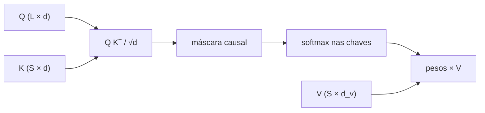
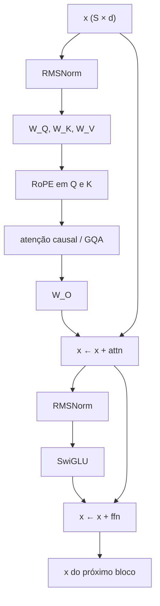

# A2 — O bloco Transformer, peça por peça

Trilha avançada, **opcional**. Guia da pasta: [`README.md`](./README.md). Checkpoint: [`checkpoint-ca2.md`](./checkpoint-ca2.md). Esta aula **não** contém gabarito de CA2.

Você já viu no M01 que o LLM *amostra* o próximo token e que um embedding é um vetor. No M09 você treinou LoRA em módulos chamados `q_proj` e `v_proj` sem abrir a conta. Aqui a conta abre. Ao final você deve conseguir, no papel e no código:

1. escrever a fórmula do produto interno escalado e dizer por que existe o `√d_k`;
2. explicar por que geração autoregressiva *exige* máscara causal;
3. desenhar um bloco (norma → atenção → soma → norma → FFN → soma);
4. contrastar encoder, decoder com cross-attention e decoder-only;
5. ler a `config` de um modelo pequeno real e reconhecer GQA, RoPE, RMSNorm e SwiGLU.

Nada disto entra nas 240 h. Não substitui C09.*. Os números miúdos abaixo foram calculados à mão e conferidos em [`lab/exemplo_numerico.py`](./lab/exemplo_numerico.py).

---

## 1. Do id de token ao vetor

O tokenizer devolve inteiros. `Segurado` pode virar dois ou três ids; `YHN-3392` quase sempre vira vários (letras, hífen, dígitos). Cada id `t` é um índice numa tabela `E` de tamanho `|V| × d`: a linha `E[t]` é o embedding daquele token. Isso **não** é o embedding de sentença do Neo4j no M01 (`exemplo-12` / `exemplo-13`). Lá um texto vira *um* vetor para busca. Aqui *cada* token vira um vetor, e a sequência vira uma matriz `X ∈ R^{S × d}`.

Dois detalhes que o LoRA do M09 já usa sem nomear:

- A cabeça que prevê o próximo token costuma **amarrar** o peso com `E` (`lm_head.weight is embed_tokens.weight`). Contar parâmetros duas vezes infla o total — o lab usa `id(tensor)` para não cair nisso.
- `d` (largura do modelo) não é o tamanho do vocabulário. SmolLM2-135M: `|V| = 49 152`, `d = 576`. Qwen2.5-0.5B: vocabulário bem maior, `d = 896`.

A tabela `E` não sabe ordem. `Ana` na posição 0 e `Ana` na posição 17 começam iguais. Posição entra depois (§7).

---

## 2. Três papéis: pergunta, chave, valor

Se cada posição só olhasse para si, o modelo seria um MLP aplicado token a token. Para escrever `"placa": "ABC-1D23"` ele precisa *misturar* o que já viu: a palavra `Placa`, o padrão `XXX-NNNN`, o valor pedido no system.

A mistura do Transformer (Vaswani et al. 2017) não é um grafo aprendido à mão. Cada posição produz três vetores, todos derivados do mesmo `x`:

```text
q_i = x_i W_Q     # "o que esta posição está perguntando"
k_j = x_j W_K     # "como esta posição se anuncia"
v_j = x_j W_V     # "o que ela carrega se for escolhida"
```

`W_Q, W_K, W_V` são matrizes `d × d_k` (ou `d × (h · d_h)` quando juntamos cabeças). No código: `q_proj`, `k_proj`, `v_proj` — os alvos clássicos de LoRA.

Intuição operacional, caso Amplitude: na hora de emitir o campo `placa`, a consulta `q` da posição atual deveria ter produto interno alto com as chaves `k` das posições que contém `Placa` e o token da placa. Isso é hipótese. O Lab A2.2 *mede* o mapa; não invente o heatmap antes de rodar.

---

## 3. Produto interno escalado — conta à mão

A fórmula (paper, §3.2.1):

```text
Attention(Q, K, V) = softmax( Q Kᵀ / √d_k ) V
```

Por que dividir por `√d_k`? O produto interno de dois vetores com coordenadas ~N(0,1) tem variância `d_k`. Sem a raiz, o softmax satura (um peso ≈ 1, o resto ≈ 0) e o gradiente some. Com a raiz, a variância dos scores volta a ~1.

Dois tokens, `d_k = 2`. Números escolhidos para caber no caderno:

```text
Q = | 1  0 |     K = | 1  0 |     V = | 1  2 |
    | 0  1 |         | 1  1 |         | 3  4 |
```

Produto `Q Kᵀ`:

```text
posição 0 pergunta: (1,0)·(1,0)=1 , (1,0)·(1,1)=1     → [1, 1]
posição 1 pergunta: (0,1)·(1,0)=0 , (0,1)·(1,1)=1     → [0, 1]
```

`√2 ≈ 1.41421356`, então `1/√2 ≈ 0.70710678`:

```text
scores / √d_k = | 0.70710678  0.70710678 |
                | 0.00000000  0.70710678 |
```

Ainda **sem** máscara, a posição 0 olharia o futuro (coluna 1). Geração token a token não pode fazer isso. Zeramos o futuro com `−∞` antes do softmax (§4). Com a máscara causal:

```text
                    | 0.70710678    −∞     |
scores mascarados = | 0.00000000  0.70710678 |
```

Softmax na linha 0: só um valor finito → pesos `[1, 0]`.  
Softmax na linha 1:

```text
e^0 = 1
e^0.70710678 ≈ 2.02811498
soma ≈ 3.02811498
pesos ≈ [0.33023846, 0.66976154]
```

Saída:

```text
posição 0: 1·(1,2) + 0·(3,4) = (1.00000000, 2.00000000)
posição 1: 0.33023846·(1,2) + 0.66976154·(3,4)
         = (2.33952308, 3.33952308)
```

`F.scaled_dot_product_attention(..., is_causal=True)` devolve os mesmos tensores em fp32 até ruído de arredondamento (nesta VM de autoria, Δ = 2,38×10⁻⁷ neste exemplo 2×2; o Lab A2.1 pede Δ < 1e-5 em tensores aleatórios). Rode `python modulo-a2/lab/exemplo_numerico.py` e confira o **seu** Δ. Não copie o da aula no CA2.



---

## 4. Não olhar o futuro

Autoregressão: o token `t` é amostrado *depois* de `0..t-1`. Se na hora de treinar a posição 3 pudesse ler a posição 7, ela “colheria” o próprio gabarito. A máscara causal é um triângulo:

```text
         chaves →
consultas  0    1    2    3
    0     ok   BLOQ BLOQ BLOQ
    1     ok    ok  BLOQ BLOQ
    2     ok    ok   ok  BLOQ
    3     ok    ok   ok   ok
```

No código: `torch.ones(L,S,dtype=bool).triu(1)` — `True` = bloqueado, preenchido com `−∞`.

Teste que não é estilo: **mude Q, K e V só na última posição**. As saídas das posições anteriores têm de ser bit-a-bit iguais (fp32, atol 1e-6). Se não forem, a máscara furou. Isso é CA2.1; a função está em `prova_que_o_futuro_nao_vaza`. O controle inverso também vale a pena: *sem* máscara, mudar o último `V` altera a posição 0.

Padding é outra máscara (não atender tokens vazios). No A2 a sequência cabe inteira; A4 trata padding/truncamento.

Self-attention *bidirecional* (encoder, BERT) deixa todas as posições se verem. Um LLM de chat **não** é isso.

---

## 5. Várias cabeças, e depois GQA

Uma cabeça aprende um tipo de ligação. O paper (§3.2.2) projeta `h` vezes, cada uma com `d_k = d / h`, concatena, e aplica `W_O`:

```text
MultiHead(X) = Concat(head_1, …, head_h) W_O
head_i       = Attention(X W_Q^i, X W_K^i, X W_V^i)
```

Custo: `h` produtos `S × S`. No desenho original `h = 8`, `d = 512`, `d_k = 64`.

LLMs pequenos barateiam K e V: **grouped-query attention** (Ainslie et al. 2023). Há `h` consultas e só `h_kv` chaves/valores (`h_kv` divide `h`). Cada grupo de `h / h_kv` cabeças de Q compartilha o mesmo par K/V. SmolLM2-135M: **9** cabeças de Q, **3** de KV, `d_h = 64` (`9×64 = 576`). Qwen2.5-0.5B: 14 Q e 2 KV. No `state_dict`, `k_proj.out_features < q_proj.out_features`. LoRA em `k_proj` e `v_proj` atualiza menos números do que em `q_proj` — útil no A6.

```text
Q:  [h0 h1 h2 h3 h4 h5 h6 h7 h8]     9 cabeças
KV: [k0       k1       k2    ]     3 cabeças, repetidas ×3
     └ h0-h2   └ h3-h5  └ h6-h8
```

---

## 6. Onde a ordem entra

### Senoides (2017)

O paper soma ao embedding um vetor determinado pela posição:

```text
PE(pos, 2i)   = sin(pos / 10000^{2i/d})
PE(pos, 2i+1) = cos(pos / 10000^{2i/d})
```

Não há parâmetro extra. A norma de cada posição, com `d` par, é `√(d/2)`: cada par sin/cos contribui 1. Há também embeddings posicionais *aprendidos* (uma tabela `S_max × d`).

O MiniDecoder do lab soma exatamente essa senoide. Serve para ver o bloco fechar. **Não** é o que SmolLM2/Qwen fazem.

### RoPE (Su et al. 2021)

Em vez de somar um vetor, RoPE **gira** Q e K no plano de cada par de coordenadas, com ângulo proporcional à posição. O produto `q_m · k_n` passa a depender de `m − n` (deslocamento relativo). Não se aplica a V.

SmolLM2-135M: `rope_theta = 100000` (não 10000), `rope_interleaved = false` — a metade baixa do vetor troca com a metade alta (`rotacionar_metade` no lab), não intercalado par a par. Qwen2.5-0.5B usa θ ainda maior (1e6 no card). O lab **não** reimplementa o cache de `inv_freq`: pede `cos, sin` ao `rotary_emb` do modelo e aplica a rotação à mão. A conta que importa para CA2.2 é a atenção + FFN, não reinventar o kernel de RoPE.

---

## 7. A rede “miolo” do bloco (FFN)

Atenção mistura posições. O FFN, *na mesma posição*, mistura canais. Paper §3.3:

```text
FFN(x) = max(0, x W_1 + b_1) W_2 + b_2
```

`d_ff` costuma ser `4 d`. ReLU no original.

LLMs atuais usam **SwiGLU** (Shazeer 2020): um ramo gera o portão `SiLU(x W_g)`, o outro o conteúdo `x W_u`, multiplicam-se, e `W_d` volta a `d`. Por isso você vê três lineares no MLP (`gate_proj`, `up_proj`, `down_proj`) e não dois. `hidden_act: silu` na config. No M09, `all-linear` no LoRA pega essas três também — A6 vai medir se vale a pena.

---

## 8. Atalho e normalização

**Resíduo** (He et al., a mesma ideia da ResNet): `x ← x + f(x)`. O bloco aprende um *delta*. Se `f` for ~0, o sinal original segue. Sem isso, 30 camadas (SmolLM2) não treinam.

**LayerNorm** (Ba, Kiros, Hinton 2016): em cada posição, média 0 e variância 1 ao longo de `d`, depois `γ ⊙ · + β`.

Conta com `x = [1, 2, 3]`, `ε = 1e-5`:

```text
μ = 2
σ² = ((1-2)² + (2-2)² + (3-2)²) / 3 = 2/3
σ = √(2/3 + 1e-5) ≈ 0.81650275
(x − μ)/σ ≈ [−1.22473562,  0.00000000,  1.22473562]
```

**RMSNorm** (Zhang & Sennrich 2019): *não* subtrai a média. Divide pela raiz da média dos quadrados e multiplica por `γ` (sem `β` no Llama/Qwen/SmolLM2).

```text
RMS = √((1²+2²+3²)/3) = √(14/3) ≈ 2.16024685
x / RMS ≈ [0.46290955, 0.92581910, 1.38872862]
```

O paper de 2017 aplica a norma *depois* da soma (pós-norma). Os modelos que você abre no A2.2 aplicam *antes* (pré-norma):

```text
x = x + Atenção( RMSNorm(x) )
x = x + FFN     ( RMSNorm(x) )
```

Pré-norma é o desenho que o lab reconstrói. Se você implementar pós-norma e comparar com o `hidden_state` do Hugging Face, o Δ explode — não é o limiar 1e-3 falhando, é o diagrama errado.



---

## 9. Encoder, decoder, decoder-only

Três desenhos, o mesmo tijolo:

| Desenho | Atenção | Uso típico |
| --- | --- | --- |
| **Encoder** | self-attention bidirecional em cada camada | BERT, encoder do translation original, encoders de embedding |
| **Decoder clássico** | (1) self-attention *causal* no alvo; (2) **cross-attention** Q do alvo, K/V da memória do encoder | Transformer NMT 2017, T5 no modo encoder-decoder |
| **Decoder-only** | só self-attention causal, empilhada | GPT, SmolLM2, Qwen2.5, o que o M09 faz fine-tune |

O desenho original (Figure 1 do paper) é encoder-decoder. O produto que você serve no Ollama é quase sempre decoder-only: uma pilha de blocos iguais, embedding no começo, RMSNorm final, `lm_head` no fim. Cross-attention **não aparece**. Se alguém pedir “o Transformer” e desenhar só o da Wikipedia de 2017, complete: o LLM de chat cortou o encoder.

Fluxo de um passo de geração (o que o M01 chama de amostrar):

```text
ids[0..t] → embeddings+RoPE → bloco × N → norma → logits em R^{|V|}
          → softmax (temperature / top-k / top-p no A1) → id t+1
          → concatena e repete
```

KV cache (A11) memoriza K e V já calculados para não refazer as posições antigas. Neste módulo você ainda recomputa a sequência inteira — de propósito, para ver a máscara.

---

## 10. Abrir um modelo de verdade

`config.json` não é decoração. No SmolLM2-135M (Apache-2.0, `model_type=llama`):

| Campo | Valor | O que significa neste módulo |
| --- | --- | --- |
| `num_hidden_layers` | 30 | quantos blocos §8 |
| `hidden_size` | 576 | `d` |
| `num_attention_heads` | 9 | cabeças de Q |
| `num_key_value_heads` | 3 | GQA |
| `head_dim` | 64 | `d_h`; 9×64=576 |
| `intermediate_size` | 1536 | largura do SwiGLU |
| `hidden_act` | `silu` | portão |
| `rms_norm_eps` | 1e-5 | ε da norma |
| `rope_parameters.rope_theta` | 100000 | base do RoPE |
| `tie_word_embeddings` | true | `lm_head` = `embed_tokens` |
| `vocab_size` | 49152 | linhas de `E` |
| `max_position_embeddings` | 8192 | teto de contexto *treinado* |

Qwen2.5-0.5B (opcional no lab) troca os números e acrescenta *bias* em Q/K/V. A reconstrução do lab usa `nn.Linear` do próprio bloco, então o bias entra se existir.

`output_attentions=True` só é confiável com `attn_implementation="eager"`. A implementação SDPA fundida **não** devolve o mapa `S × S`. O lab força `eager`.

Contagem: some `p.numel()` **uma vez por `id(p)`**. Compare com `model.num_parameters()`. CA2.2 pede erro relativo ≤ 0,1%. A tabela por componente (embedding / atenção / FFN / norma / lm_head) é sua: o JSON não vem preenchido nesta aula.

Reconstruir o bloco 0: pegue `hidden_states[0]` (saída do embedding), aplique RMSNorm → QKV → RoPE → GQA → softmax causal → `o_proj` → soma → RMSNorm → SwiGLU → soma. O resultado tem de casar com `hidden_states[1]`. Tolerância 1e-3 em fp32; na VM de autoria o Δ máximo foi 0.0 nesse modelo — o seu número é o do seu JSON.

A frase padrão do lab é original (`Segurado: Ana Souza. Placa: ABC-1D23.`), no espírito do caso Amplitude, **sem** copiar os JSONL do M09.

---

## 11. Ponte com o tronco

- M01 `exemplo-04`: temperature/top-K mexem no softmax **depois** deste bloco. Sem o bloco, o slider é magia; com o bloco, é amostragem em `R^{|V|}`.
- M09 LoRA: `target_modules` aponta para as matrizes que você acabou de nomear. Rank baixo = atualizar `W_Q` (etc.) com `BA`. Merge (A6) é `W ← W + BA`.
- `referencia/llm-course/tools/minigpt.py` (Apache-2.0, Luciano de Oliveira Nunes): um MiniGPT com RMSNorm + RoPE + SwiGLU. Leitura de código, não desta aula. Módulo 02 completo daquele curso **não** está no recorte vendored.

---

## 12. Labs e o que entregar

Faça na ordem. Critérios verificáveis: [`checkpoint-ca2.md`](./checkpoint-ca2.md).

1. Leia esta aula e rode `exemplo_numerico.py`.
2. Leia `lab/atencao.py` e `lab/bloco.py`.
3. `python modulo-a2/lab/lab_a2.py` → `saidas/ca2.json`.
4. `python -m pytest modulo-a2/testes -q`.
5. No relatório curto: (a) o Δ do A2.1; (b) se o teste causal passou; (c) tabela de parâmetros; (d) Δ do bloco reconstruído; (e) **uma** observação sobre o mapa da cabeça 0 — qual chave a posição da placa mais atende, sem inventar se o JSON não mostrar.

Tutor socrático opcional: [`tutor/mapa-a2.md`](./tutor/mapa-a2.md). Níveis 0–5 não são nota.

Referências primárias: [`referencias.md`](./referencias.md).
